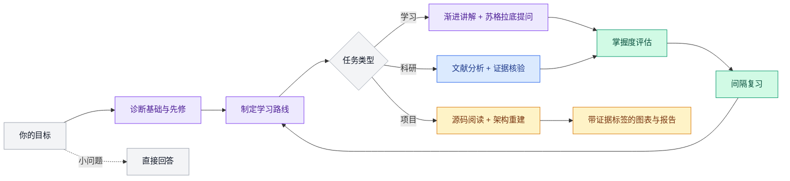

<div align="center">

# Universal Learning & Research Architect

*通用学习 · 学术科研 · 知识工程 · 代码库分析*

[](https://github.com/RoxA-7/universal-learning-research)


[中文说明](#中文说明) · [English](#english)

</div>

---

## 中文说明

### 🎯 这是什么

**Universal Learning & Research Architect** 是一个面向 AI Agent 的通用学习与科研 Skill。它把「学习」「读文献」「分析代码」组织成可验证的工作流，帮助 Agent 判断一件事：你只是读过了，还是真的能解释、能应用、能迁移。

**适合谁**：正在系统学习某门学科、准备精读一篇论文，或需要接手一个陌生代码库的人。

它不追求产出更多摘要、笔记和图表，而是追求三件事：

- **讲得对** —— 区分事实、来源结论、独立验证与推测，不编造引用、数据或代码行为。
- **学得会** —— 先诊断基础和先修，再决定讲到多深；用提问、练习和复述检验理解。
- **带得走** —— 把知识组织成可复用、可复习的结构，而不是一次性问答。

### 🧭 四种工作模式

| 模式 | 适用场景 | 你会得到 |
| :--- | :--- | :--- |
| **A · 快速学习** | 单个概念、临时疑问 | 直接回答 + 关键推理 + 一个可选的小检验 |
| **B · 系统学习** | 系统学习一门学科或技术（先诊断基础，再按先修进阶） | 基础诊断 → 先修地图 → 分阶段路线 → 渐进讲解与苏格拉底式检查 → 掌握度评估 |
| **C · 科研与文献** | 读论文、做综述、找方向 | 结构化论文分析 + 证据溯源 + 研究空白 + 理解检验 |
| **D · 项目与代码库** | 读懂真实软件项目 | 带源码证据的架构、调用链、数据流与图表 |

模式可以组合，也可以中途切换；小问题走最短路径，不会被强行套上完整流程。

**能力地图**：**书籍与文档**（提取概念、论证、公式与案例，保留章节/页码出处）· **研究→知识流水线**（来源 → 检索 → 原文核验 → 结构化分析 → 概念与方法提取 → 教学与检验 → 可视化 → 知识与研究空白）· **知识图谱**（先修、组成、对比与跨领域联系）。

**输出与追踪**：**输出模板**（概念笔记 / 论文笔记 / 学习进度报告）· **缺口检测与增量更新** · **掌握度与间隔复习**。

### 🔄 它如何工作



### 💬 用法示例

下面四个示例分别对应 B / A / C / D 四种模式；换成你自己的主题，用法完全一样。

**① 从零学一门语言 · 模式 B**

```text
我想从零开始学西班牙语，每天只有 30 分钟。
请先诊断我的基础，再给出三个月学习路线，并从第一课开始。
每讲完一个概念，用两个问题检验我是否真的理解。
```

**② 理解一个具体概念 · 模式 A**

```text
请解释摄影里的曝光三要素：光圈、快门、ISO。
先用直觉说明它们如何互相补偿，再给我三个拍摄场景判断参数，
最后检查我能否独立解释并给出合理参数。
```

**③ 整理一个陌生领域的文献 · 模式 C**

```text
请围绕「城市骑行安全」整理相关研究：比较不同论文的研究问题、
方法、数据与结论，归纳进展与空白。保留来源，不要编造引用。
```

**④ 读懂一个开源项目 · 模式 D**

```text
请检查当前代码仓库：先盘点技术栈与入口，再分析模块职责、依赖与关键调用链。
生成带源码依据的架构图，并用 VERIFIED / INFERRED 标注每条结论的可信度。
```

> **通用模板**：告诉我「想学 / 想研究 / 想分析什么」「目前的基础」「期望的产出」，流程会随任务复杂度自动裁剪。

### 🧱 代码库逆向分析

面对一个陌生仓库，先盘点再下结论，而不是照着 README 的目录名猜架构：

1. 盘点目录、语言、技术栈、配置与项目入口。
2. 分析模块职责、依赖、API、数据库与基础设施。
3. 追踪关键调用链、执行路径与数据流。
4. 重建组件边界与部署关系。
5. 生成与源码对应的架构图、依赖图与数据流图。
6. 输出技术报告、图表源文件与证据索引。

每条重要结论都会标注可信度：

| 标签 | 含义 | 在报告中的处理 |
| :--- | :--- | :--- |
| ✅ **VERIFIED** | 源码、配置或已验证的运行行为直接支持 | 作为结论，尽量附文件与行号；无法定位时说明原因 |
| 🟡 **INFERRED** | 结构与依赖强烈暗示，但未直接确认 | 标注推断依据 |
| 🔵 **ASSUMED** | 分析所需的临时假设 | 列入待确认清单 |
| ⚪ **UNVERIFIED** | 当前无法确认 | 写明未覆盖范围与原因 |

> 大型仓库会分批检查并报告覆盖范围：看过多少、跳过什么、哪些结论仍待验证。

### 📊 智能可视化

**确定目的 → 界定范围 → 提取实体与关系 → 构建结构化模型 → 选择图型 → 生成 → 校验 → 迭代 → 交付（图 + 可编辑源 + 说明与出处）**

| 图型 | 回答的问题 |
| :--- | :--- |
| 架构图 | 系统由哪些部分组成，边界与职责如何划分 |
| 流程图 | 一个过程或算法如何一步步执行 |
| 时序图 | 组件之间按时间顺序如何交互 |
| 数据流图 | 数据从哪来、经过什么变换、到哪去 |
| 依赖图 | 模块、包或概念之间谁依赖谁 |
| 知识图谱 | 概念之间的先修、组成、对比与跨领域联系 |
| 状态图 | 系统在哪些状态之间迁移 |
| 类图 / ER 图 | 代码对象或数据库实体如何建模 |
| 时间线 / 路线图 | 计划与里程碑如何排布 |

输出格式按宿主环境选择 **Mermaid、Graphviz/DOT、SVG、HTML、Markdown 或 JSON**（JSON 用于结构化模型），并尽量保留可编辑源文件。图表对实际结构负责，而不是为了视觉效果堆节点。

### 📚 文献管理与 Zotero

Zotero 是首选的文献管理工具。

- 使用前先确认环境中真实可用的能力：检索条目、读取元数据与 PDF、读取标注与笔记等。
- 只声称验证过可用的集成；没有 Zotero 连接时，改用导出数据、BibTeX 或用户提供的 PDF 工作。
- 尊重已有文献库：先查重，不擅自重组、删除或覆盖笔记与标注。
- 论文结论、转述、引用与推断分开标注；无法核实的来源会明确说明。

### 🌱 掌握度与复习

阅读、收藏、生成笔记都不等于掌握。重要概念会按证据评估：

| 等级 | 名称 | 判断依据 |
| :---: | :--- | :--- |
| 0 | 未知 | 尚未学习或评估 |
| 1 | 识别 | 能认出术语与基本含义 |
| 2 | 理解 | 能准确解释概念 |
| 3 | 应用 | 能在实际问题中使用 |
| 4 | 掌握 | 能独立扩展、评估并教会别人 |

复习间隔建议为 **1 → 3 → 7 → 14 → 30 天**，并根据实际表现动态调整；错过一次复习不等于已经掌握。

### 🚀 安装

技能定义位于仓库根目录的 `SKILL.md`，其 YAML frontmatter 包含 `name` / `version` / `description`；按平台要求完成配置后即可加载。

1. 克隆或下载本仓库。
2. 将整个文件夹放入平台能识别的 skills 目录；多数平台要求目录内存在 `SKILL.md`。
3. 按平台要求完成配置；若支持显式调用，使用名称 `universal-learning-research`。
4. 打开新会话，确认 Agent 已读取技能定义。

常见存放位置示例（不同客户端要求不同，以平台文档为准）：

```text
~/.claude/skills/universal-learning-research/SKILL.md
~/.agents/skills/universal-learning-research/SKILL.md
C:\Users\<你>\.claude\skills\universal-learning-research\SKILL.md
```

### ⚖️ 设计原则

| 原则 | 含义 |
| :--- | :--- |
| 理解优先 | 用解释、推导、应用和测验检验真实理解，而不是统计阅读量 |
| 证据驱动 | 区分来源事实、独立验证与 Agent 推断；无法验证就说不确定 |
| 渐进式工作 | 简单问题直接回答，复杂任务才启动完整工作流 |
| 工具开放 | 优先通用、可读、可编辑的格式，降低平台锁定 |
| 持续积累 | 把学习与研究成果沉淀为可检索、可关联的知识资产 |

### 🛡️ 安全与隐私

- 默认以静态阅读和分析为主，不自动执行不可信代码。
- 不在报告、图表或日志中暴露 API Key、密码、令牌等敏感信息。
- 未经授权不修改源代码、不安装依赖、不上传项目文件。
- 分析私有仓库与研究资料时，遵守用户及组织的数据安全要求。
- 无法访问的文件或工具会如实说明，不伪造分析结果。

### 🧩 适用场景

| 学习与科研 | 工程与知识管理 |
| :--- | :--- |
| 系统学习新学科，补齐先修 | 接手陌生项目、技术调研 |
| 课程学习与知识体系构建 | 代码库架构分析与文档生成 |
| 论文精读、文献综述与选题 | 架构图、流程图、时序图等可视化 |
| 掌握度评估与间隔复习 | 个人知识图谱与笔记组织 |

### 🚧 能力边界

本 Skill 提供的是方法论、流程规范与质量标准，而不是具体工具本身。它不会自动获得文件系统、网络、Zotero、代码执行或图像渲染能力；如果宿主环境缺少某项能力，会如实说明限制并给出替代方案，而不是假装完成。

> 判断成功的标准不是产出了多少摘要和图表，而是你能否独立理解、应用、解释、评估并扩展知识。

---

## English

### 🎯 What It Is

**Universal Learning & Research Architect** is a general-purpose skill for AI agents that turns learning, literature research, and codebase analysis into verifiable workflows. It helps an agent distinguish whether you simply finished reading something or can actually explain, apply, and transfer it.

**Who it is for:** anyone studying a subject systematically, reading a paper closely, or taking over an unfamiliar codebase.

It does not optimize for the number of summaries, notes, or diagrams; it optimizes for three things:

- **Accurate:** separates source claims, verified findings, and inference; never fabricates citations, results, or code behavior.
- **Effective:** diagnoses prior knowledge first, then adapts depth; checks understanding with questions, exercises, and explanation.
- **Durable:** organizes knowledge into reusable, reviewable structures instead of one-off answers.

### 🧭 Four Modes

| Mode | Use it for | What you get |
| :--- | :--- | :--- |
| **A · Quick Learning** | A single concept or question | Direct answer + key reasoning + optional check |
| **B · Deep Learning** | Learning a subject systematically (diagnose first, then build from prerequisites to advanced material) | Diagnosis → prerequisite map → staged roadmap → progressive teaching with Socratic checks → mastery assessment |
| **C · Research & Literature** | Papers, literature reviews, topic discovery | Structured paper analysis + evidence traceability + research gaps + understanding checks |
| **D · Project & Codebase** | Understanding a real software project | Source-grounded architecture, call paths, data flows, and diagrams |

Modes can be combined or switched mid-task; small questions take the shortest path.

**Capability map:** **books and documents** (concepts, arguments, formulas, and cases with chapter/page provenance) · **research→knowledge pipeline** (sources → search → source verification → structured analysis → concept and method extraction → teaching and checks → visualization → knowledge and research gaps) · **knowledge graphs** (prerequisite, compositional, comparative, and cross-domain links).

**Outputs and tracking:** **output templates** (concept notes / paper notes / progress reports) · **gap detection and incremental updates** · **mastery and spaced review**.

### 🔄 How It Works

The loop is shown in the diagram above: **diagnose → plan → teach / research / analyze → assess → review**. The workflow scales to the task; a quick question never receives a full research pipeline.

### 💬 Examples

The four examples map to Modes B, A, C, and D respectively; swap in your own topic and the workflow stays the same.

**① Learning a language · Mode B**

```text
I want to learn Spanish from scratch with 30 minutes a day.
Assess my level first, build a three-month roadmap, then start the first lesson.
After each concept, quiz me with two questions to check real understanding.
```

**② Understanding a concept · Mode A**

```text
Explain the exposure triangle in photography: aperture, shutter speed, and ISO.
Start with intuition, show how they compensate for each other,
then give me three shooting scenarios and check whether I can explain it and choose sensible settings.
```

**③ Reviewing literature in an unfamiliar field · Mode C**

```text
Organize the research on urban cycling safety: compare research questions,
methods, data, and findings, and summarize progress and gaps.
Keep sources traceable and do not invent citations.
```

**④ Understanding an open-source project · Mode D**

```text
Inspect this repository: inventory the stack and entry points, then analyze
module responsibilities, dependencies, and key call paths. Produce a
source-grounded architecture diagram and label findings as VERIFIED or INFERRED.
```

> **General template:** tell the agent what you want to learn, research, or analyze, your current level, and the output you expect — the workflow scales to the task.

### 🧱 Codebase Reverse Engineering

The agent inventories before concluding and grounds findings in source:

1. Inventory structure, languages, frameworks, configuration, and entry points.
2. Analyze module responsibilities, dependencies, APIs, databases, and infrastructure.
3. Trace execution paths, call graphs, and data flows.
4. Reconstruct component boundaries and deployment architecture.
5. Generate source-grounded architecture and dependency diagrams.
6. Produce reports, editable diagram sources, and an evidence index.

| Label | Meaning | Handling in reports |
| :--- | :--- | :--- |
| ✅ **VERIFIED** | Directly supported by source, configuration, or validated runtime behavior | State as fact; cite files and line ranges where possible, and explain when a location cannot be determined |
| 🟡 **INFERRED** | Strongly implied by structure but not directly confirmed | Mark the inference basis |
| 🔵 **ASSUMED** | Working assumption, tracked for confirmation | List as an open item |
| ⚪ **UNVERIFIED** | Cannot currently be confirmed | State the uninspected scope and why |

Large repositories are inspected incrementally, and coverage and limitations are reported honestly.

### 📊 Visualization

**Define purpose → scope → extract entities and relationships → build a structured model → choose notation → render → validate → iterate → deliver (diagram + editable source + explanation and references)**

Supported types include architecture, flowchart, sequence, data-flow, dependency, knowledge graph, state, class/ER, and timeline/roadmap diagrams. Outputs may use **Mermaid, Graphviz/DOT, SVG, HTML, Markdown, or JSON** (JSON for structured models), with editable sources preserved where possible. Diagrams answer a clear question rather than decorate one.

### 📚 Literature and Zotero

Zotero is the preferred reference manager.

- Verify real access before claiming integration: library search, metadata, PDFs, annotations.
- Without Zotero access, work from exported data, BibTeX, or user-provided PDFs.
- Respect existing libraries: search before adding; never silently overwrite or delete notes and annotations.
- Keep source claims, verified findings, and inference distinguishable.

### 🌱 Mastery and Review

Reading, bookmarking, and note-taking do not demonstrate mastery. Concepts are rated on evidence: **0 Unknown → 1 Recognition → 2 Understanding → 3 Application → 4 Mastery**. Reading alone never raises a level.

Suggested review intervals: **1 → 3 → 7 → 14 → 30 days**, adapted to demonstrated performance. A missed review does not imply mastery.

### 🚀 Installation

The skill definition is `SKILL.md` at the repository root; its YAML frontmatter provides `name`, `version`, and `description`.

1. Clone or download this repository.
2. Place the folder in the skills directory your platform recognizes; most platforms expect a `SKILL.md` inside it.
3. Complete any platform-specific configuration. If explicit invocation is supported, use `universal-learning-research`.
4. Start a new session and verify that the skill was loaded.

Common locations (requirements vary by client; check the platform documentation):

```text
~/.claude/skills/universal-learning-research/SKILL.md
~/.agents/skills/universal-learning-research/SKILL.md
C:\Users\<you>\.claude\skills\universal-learning-research\SKILL.md
```

### ⚖️ Design Principles

- **Understanding first:** explanations, derivations, and tests — not reading counts.
- **Evidence-driven:** distinguish source facts, verified findings, and inference.
- **Progressive workflows:** only as much process as the task requires.
- **Tool flexibility:** portable, readable, editable formats.
- **Continuous knowledge building:** learning and research become reusable assets.

### 🛡️ Security and Privacy

- Prefer static inspection; do not execute untrusted code by default.
- Never expose keys, passwords, or tokens in reports, diagrams, or logs.
- Do not modify source, install dependencies, or upload project files without authorization.
- Respect data-security requirements for private repositories and research materials.
- Clearly report inaccessible resources; never fake results.

### 🧩 Use Cases

- Learning new subjects and closing prerequisite gaps
- Coursework and personal knowledge-system building
- Paper reading, literature reviews, and research topic discovery
- Codebase onboarding, architecture analysis, and technical investigation
- Architecture, flow, sequence, and knowledge-graph visualization
- Personal knowledge graphs and note organization
- Mastery tracking and spaced review

### 🚧 Limitations

This skill defines workflows, standards, and methods — not tools. It does not independently grant filesystem, network, reference-manager, code-execution, or rendering capabilities; when the host lacks a capability, the skill states the limitation instead of pretending to complete the task.

> Success is not counted in summaries and diagrams, but in your ability to independently understand, apply, explain, evaluate, and extend knowledge.

---

## 仓库结构 / Repository Structure

```text
universal-learning-research/
├── SKILL.md     # Skill definition (front matter + full instructions)
├── README.md    # This document
└── LICENSE      # MIT
```

## 贡献 / Contributing

欢迎提交改进、问题与使用反馈。提议优化时，请优先保证：

- 流程清晰、可验证；
- 跨 Agent 平台兼容；
- 来源可追溯、不确定性标注清楚；
- 输出可编辑，工具依赖可替换；
- 真正提升学习效果，而不是增加自动化表演。

Contributions, issues, and feedback are welcome. Proposals should keep workflows verifiable, remain portable across agent platforms, preserve source traceability and uncertainty labels, and improve learning outcomes rather than adding automation for its own sake.

## 许可证 / License

本项目采用 [MIT License](LICENSE)。

This project is licensed under the [MIT License](LICENSE).
